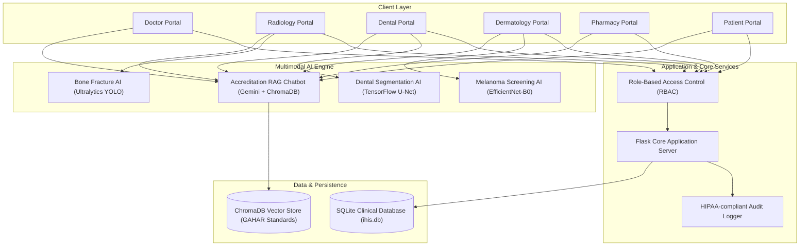

# Integrated Hospital Information System (IHIS) & Multimodal Clinical AI Platform

[](https://www.python.org/downloads/)
[](https://palletsprojects.com/p/flask/)
[](https://pytorch.org/)
[](https://www.trychroma.com/)
[](LICENSE)

An enterprise-grade, multimodal clinical operations platform and Electronic Health Record (EHR) system. IHIS unifies specialized medical artificial intelligence models—**Radiology Bone Fracture Localization (YOLO)**, **Dental Panoramic Segmentation (U-Net)**, **Dermatology Melanoma Screening (EfficientNet)**, and a **Hospital Accreditation Compliance Assistant (RAG)**—into a seamless, cohesive clinical workflow.

---

## 🌟 Executive Overview & Architectural Vision

Modern healthcare institutions often suffer from fragmented software ecosystems where diagnostic AI tools run in isolated silos separate from patient health records, order entry, and pharmacy workflows. 

**IHIS was architected to bridge this gap.** It acts as a single, centralized nervous system that connects hospital administrators, physicians, radiologists, dentists, pharmacists, and patients with real-time AI assistive diagnostics directly at the point of care.



---

## 📅 Chronological Development & Engineering Milestones

The platform represents the synthesis of iterative, focused AI research projects engineered into an integrated production system:

| Date | Milestone / Component | Engineering Rationale & Architectural Significance |
| :--- | :--- | :--- |
| **July 2026** | **Computer Vision Foundations** | Developed standalone deep learning prototypes for medical imaging: dental panoramic X-ray segmentation via custom Keras/TensorFlow architectures and bone fracture localization using YOLO object detection. |
| **September 4, 2026** | **Core EHR & Offline Radiology AI** | Architected the Flask core backend, relational schemas (Patients, Doctors, Medical Records, Orders), and integrated the offline YOLO fracture model into the Radiology order lifecycle. |
| **September 4, 2026** | **Clinical Examination & Order Hubs** | Built comprehensive SOAP clinical examination sheets, dynamic vital signs tracking, drug sensitivity warnings, and cross-department order routing (Lab, Radiology, Pharmacy). |
| **September 6, 2026** | **Dermatology AI Integration** | Implemented an EfficientNet-B0 transfer learning pipeline with test suites to classify dermatological lesions and melanoma risks from patient skin photographs. |
| **September 10, 2026** | **GAHAR Accreditation RAG Assistant** | Integrated LangChain, ChromaDB, and Google Gemini to index the official Egyptian General Authority for Healthcare Accreditation and Regulation (GAHAR) manual into an always-available conversational compliance widget. |
| **September 11–October 2026** | **Unified Dental U-Net & System Hardening** | Integrated the 1.49 MB quantized dental U-Net model with morphological edge-cleaning post-processing into the Dental portal, stabilized dependency configurations, and established 1-click startup automation. |

---

## 🔬 Multimodal Clinical AI Modules

### 1. Radiology Bone Fracture Detection (Ultralytics YOLO)
- **Modality:** Plain Radiographs (AP & Lateral views: wrist, hand, extremity).
- **Functionality:** Inspects uploaded radiographs, localizes fracture boundaries with high-precision bounding boxes, computes detection confidence percentages, and saves annotated diagnostic overlays.
- **Workflow Integration:** Directly triggered from Radiology Orders created by attending physicians.

### 2. Dental Panoramic Segmentation (TensorFlow / Keras U-Net)
- **Modality:** Panoramic Dental Radiographs (OPG).
- **Functionality:** 
  - Standardizes input images to (128x128x1) normalized grayscale tensors.
  - Generates binary segmentation masks separating tooth structures from mandibular/maxillary bone.
  - Applies automated morphological cleaning (border margin zeroing, connected component analysis, noise speckle removal).
  - Returns both high-contrast black/white masks and 40% alpha red diagnostic overlays.

### 3. Dermatology Melanoma Screening (PyTorch EfficientNet-B0)
- **Modality:** Clinical Dermatoscopic and Macroscopic Skin Photographs.
- **Functionality:** Leverages deep feature embeddings to categorize skin lesions into risk categories, flagging high-risk melanoma patterns for urgent biopsy referral.

### 4. GAHAR Hospital Accreditation Compliance Assistant (RAG)
- **Knowledge Base:** Official GAHAR Handbook for Hospital Accreditation Standards.
- **Architecture:** Document chunking via `langchain-text-splitters`, embedding storage in local `ChromaDB`, and contextual question-answering powered by `google-generativeai`.
- **UI:** Injected universally across every hospital portal via a floating, responsive drawer widget.

---

## 👥 Role-Based Portals & Clinical Capabilities

| Portal | Primary Responsibilities & Features |
| :--- | :--- |
| **Doctor Portal** | Patient intake, clinical examination sheets, ICD-10 diagnostic coding, drug allergy checks, and digital ancillary order generation. |
| **Radiology Portal** | Worklist for pending imaging orders, radiograph upload interface, automated YOLO inference, and diagnostic report sign-off. |
| **Dental Portal** | Dental charts, procedure logs, periodontal records, and instant U-Net dental X-ray segmentation. |
| **Dermatology Portal** | Photographic skin lesion documentation and automated risk assessment. |
| **Pharmacy Portal** | Prescription fulfillment queue, real-time drug allergy conflict detection, and dosage verification. |
| **Patient Portal** | Secure personal health records (PHR), visit summaries, lab test results, and imaging history. |
| **Admin Portal** | System role assignments, user management, and automated HIPAA/audit log inspection. |

---

## ⚡ 1-Click Scalable Startup (`start_app.bat`)

To ensure effortless deployment on Windows workstations without manual command-line configuration, a modular, self-healing startup batch script (`start_app.bat`) is included in the root directory.

### How to Run:
Simply double-click `start_app.bat`.

```
=====================================================================
          INTEGRATED HOSPITAL INFORMATION SYSTEM (IHIS)              
         Multimodal Clinical AI Platform - Automated Launcher        
=====================================================================
```

### Execution Pipeline:
1. **[STEP 1/6] Python Runtime Detection:** Automatically checks for Python 3.11 (ideal for ML binary wheels) or falls back to the system Python.
2. **[STEP 2/6] Virtual Environment Setup:** Initializes a dedicated `.venv` if one does not exist, upgrades pip, and activates the environment.
3. **[STEP 3/6] Dependency Verification:** Checks core packages and re-syncs missing libraries from `requirements.txt`.
4. **[STEP 4/6] Security & Secret Guardrails:** Verifies local `.env`. If absent, prompts safely for an optional Gemini API key (vision models remain fully functional offline without an API key).
5. **[STEP 5/6] Knowledge Base Verification:** Verifies the ChromaDB vector database. If missing, automatically parses and embeds the GAHAR handbook via `ingest.py`.
6. **[STEP 6/6] Database Seeding:** Verifies `database/ihis.db`. If uninitialized, executes `seed.py` with mock clinical records and accounts.
7. **[LAUNCH]:** Automatically opens `http://127.0.0.1:5000` in your default browser and starts the Flask server.

---

## 🔑 Pre-Seeded Demonstration Accounts

All demo accounts are configured with the default demonstration password: **`password123`**

| Role / Department | Username | Purpose / Recommended Demo Walkthrough |
| :--- | :--- | :--- |
| **Attending Doctor** | `doctor1` | Review Patient 1's wrist trauma exam, allergy alerts, and radiology orders. |
| **Dentist** | `dentist1` | Access Dental cases and perform U-Net Dental X-Ray AI segmentation. |
| **Dermatology Doctor** | `derm_doctor` | Inspect dermatological skin lesion uploads and AI analysis. |
| **Patient (John Doe)** | `patient1` | View personal medical record, vitals, and completed lab/imaging reports. |
| **Patient (Jane Smith)** | `patient2` | View secondary chronic care records and prescriptions. |

---

## 🛡️ Security, Privacy & Secret Management

- **Zero Hardcoded Credentials:** No production credentials, private tokens, or Google API keys are committed to Git.
- **Git Guardrails:** `.env`, `.env.local`, SQLite databases with runtime data, and vector indexes are strictly excluded via `.gitignore`.
- **Role-Based Access Control (RBAC):** Every endpoint is guarded with custom `@role_required` decorators preventing horizontal and vertical privilege escalation.
- **Audit Trails:** Critical clinical actions (logins, order updates, prescription approvals) are persistently recorded in the `audit_logs` table.

---

## 🛠️ Technology Stack

- **Core Web Framework:** Flask 3.0, Jinja2, Bootstrap 5, FontAwesome
- **Database & ORM:** SQLite 3, SQLAlchemy 2.0, Flask-Login
- **Computer Vision & Deep Learning:** Ultralytics YOLOv8, PyTorch, Torchvision, TensorFlow / Keras 3, OpenCV, Pillow, Timm
- **Generative AI & Vector Search:** ChromaDB, Google Gemini API, LangChain Text Splitters, PyPDF
- **Testing & Quality Assurance:** Pytest, unittest
